# GEOGRAFIE::Romania::Judete

Q: Care este municipiul reședință al județului Alba (AB)?
A: Alba Iulia
E: 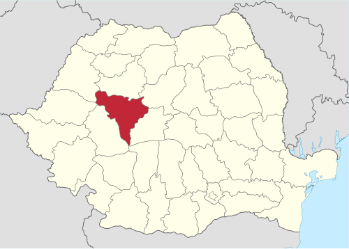{width=500}

---

Q: Ce județ (RO) are municipiul reședință Alba Iulia (prescurtare AB)?
A: Județul Alba
E: {width=500}

---

Q: Care este municipiul reședință al județului Arad (AR)?
A: Arad
E: 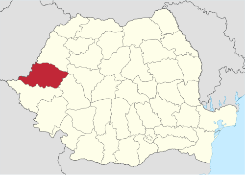{width=500}

---

Q: Ce județ (RO) are municipiul reședință Arad (prescurtare AR)?
A: Județul Arad
E: {width=500}

---

Q: Care este municipiul reședință al județului Argeș (AG)?
A: Pitești
E: 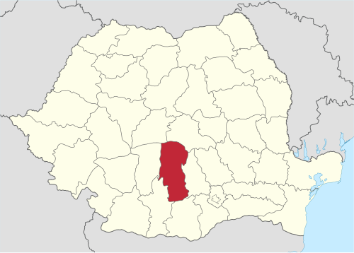{width=500}

---

Q: Ce județ (RO) are municipiul reședință Pitești (prescurtare AG)?
A: Județul Argeș
E: {width=500}

---

Q: Care este municipiul reședință al județului Bacău (BC)?
A: Bacău
E: 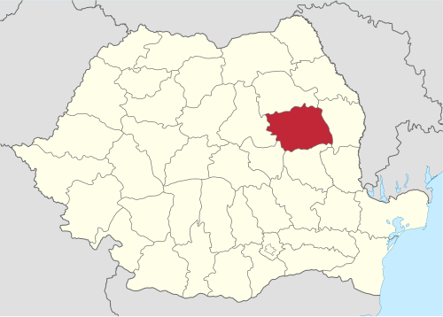{width=500}

---

Q: Ce județ (RO) are municipiul reședință Bacău (prescurtare BC)?
A: Județul Bacău
E: {width=500}

---

Q: Care este municipiul reședință al județului Bihor (BH)?
A: Oradea
E: 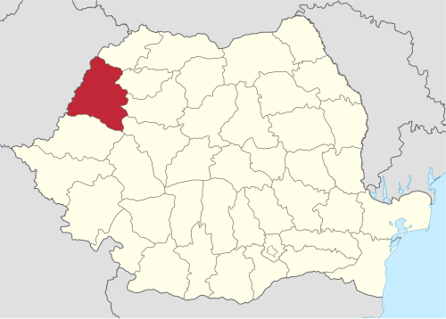{width=500}

---

Q: Ce județ (RO) are municipiul reședință Oradea (prescurtare BH)?
A: Județul Bihor
E: {width=500}

---

Q: Care este municipiul reședință al județului Bistrița-Năsăud (BN)?
A: Bistrița
E: 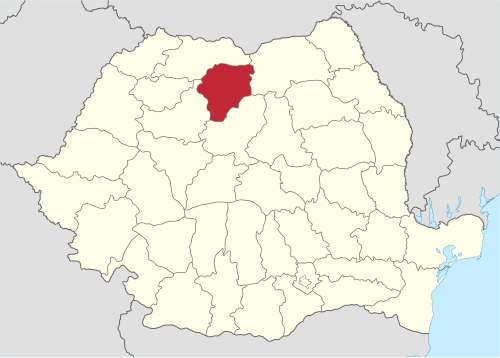{width=500}

---

Q: Ce județ (RO) are municipiul reședință Bistrița (prescurtare BN)?
A: Județul Bistrița-Năsăud
E: {width=500}

---

Q: Care este municipiul reședință al județului Botoșani (BT)?
A: Botoșani
E: 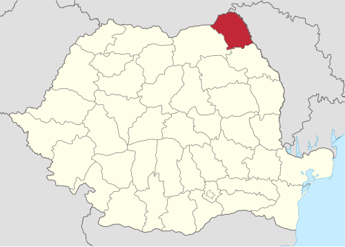{width=500}

---

Q: Ce județ (RO) are municipiul reședință Botoșani (prescurtare BT)?
A: Județul Botoșani
E: {width=500}

---

Q: Care este municipiul reședință al județului Brașov (BV)?
A: Brașov
E: 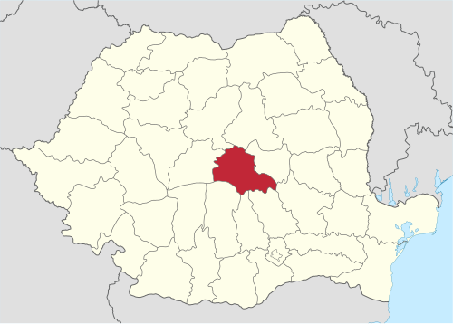{width=500}

---

Q: Ce județ (RO) are municipiul reședință Brașov (prescurtare BV)?
A: Județul Brașov
E: {width=500}

---

Q: Care este municipiul reședință al județului Brăila (BR)?
A: Brăila
E: 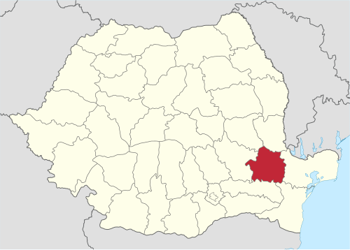{width=500}

---

Q: Ce județ (RO) are municipiul reședință Brăila (prescurtare BR)?
A: Județul Brăila
E: {width=500}

---

Q: Care este municipiul reședință al județului Buzău (BZ)?
A: Buzău
E: 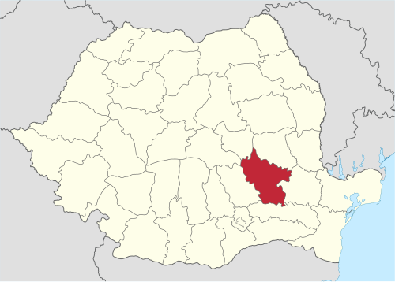{width=500}

---

Q: Ce județ (RO) are municipiul reședință Buzău (prescurtare BZ)?
A: Județul Buzău
E: {width=500}

---

Q: Care este municipiul reședință al județului Caraș-Severin (CS)?
A: Reșița
E: 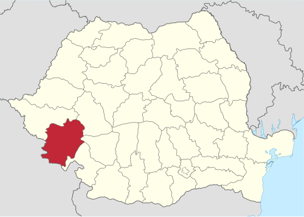{width=500}

---

Q: Ce județ (RO) are municipiul reședință Reșița (prescurtare CS)?
A: Județul Caraș-Severin
E: {width=500}

---

Q: Care este municipiul reședință al județului Călărași (CL)?
A: Călărași
E: 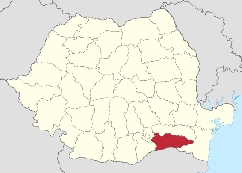{width=500}

---

Q: Ce județ (RO) are municipiul reședință Călărași (prescurtare CL)?
A: Județul Călărași
E: {width=500}

---

Q: Care este municipiul reședință al județului Cluj (CJ)?
A: Cluj-Napoca
E: 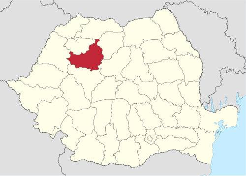{width=500}

---

Q: Ce județ (RO) are municipiul reședință Cluj-Napoca (prescurtare CJ)?
A: Județul Cluj
E: {width=500}

---

Q: Care este municipiul reședință al județului Constanța (CT)?
A: Constanța
E: 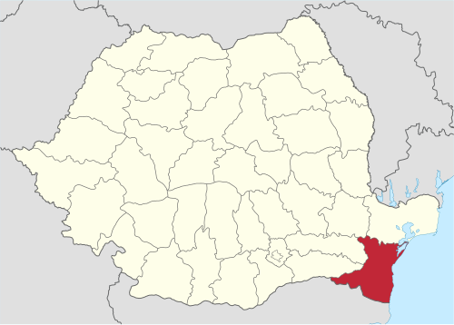{width=500}

---

Q: Ce județ (RO) are municipiul reședință Constanța (prescurtare CT)?
A: Județul Constanța
E: {width=500}

---

Q: Care este municipiul reședință al județului Covasna (CV)?
A: Sfântu Gheorghe
E: 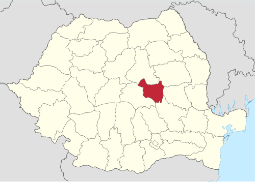{width=500}

---

Q: Ce județ (RO) are municipiul reședință Sfântu Gheorghe (prescurtare CV)?
A: Județul Covasna
E: {width=500}

---

Q: Care este municipiul reședință al județului Dâmbovița (DB)?
A: Târgoviște
E: 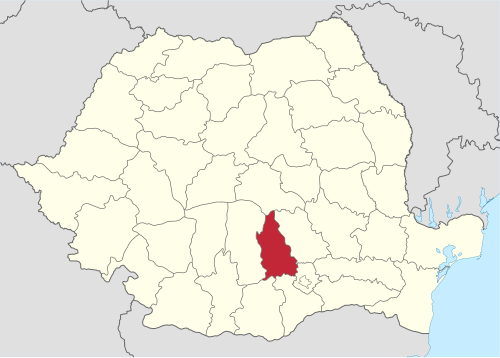{width=500}

---

Q: Ce județ (RO) are municipiul reședință Târgoviște (prescurtare DB)?
A: Județul Dâmbovița
E: {width=500}

---

Q: Care este municipiul reședință al județului Dolj (DJ)?
A: Craiova
E: 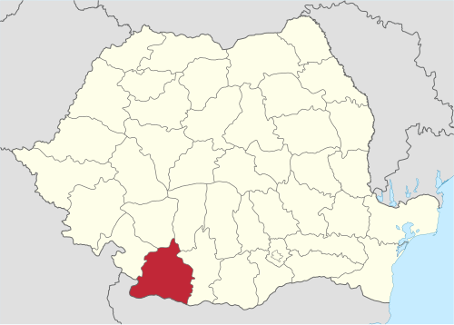{width=500}

---

Q: Ce județ (RO) are municipiul reședință Craiova (prescurtare DJ)?
A: Județul Dolj
E: {width=500}

---

Q: Care este municipiul reședință al județului Galați (GL)?
A: Galați
E: 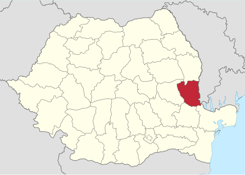{width=500}

---

Q: Ce județ (RO) are municipiul reședință Galați (prescurtare GL)?
A: Județul Galați
E: {width=500}

---

Q: Care este municipiul reședință al județului Giurgiu (GR)?
A: Giurgiu
E: 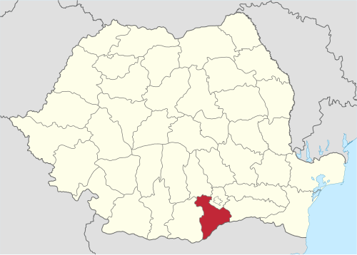{width=500}

---

Q: Ce județ (RO) are municipiul reședință Giurgiu (prescurtare GR)?
A: Județul Giurgiu
E: {width=500}

---

Q: Care este municipiul reședință al județului Gorj (GJ)?
A: Târgu Jiu
E: 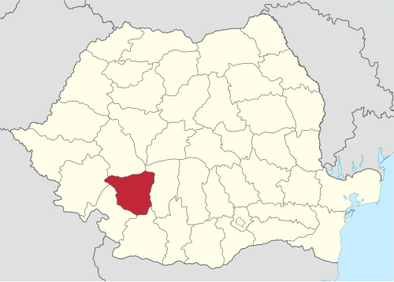{width=500}

---

Q: Ce județ (RO) are municipiul reședință Târgu Jiu (prescurtare GJ)?
A: Județul Gorj
E: {width=500}

---

Q: Care este municipiul reședință al județului Harghita (HR)?
A: Miercurea Ciuc
E: 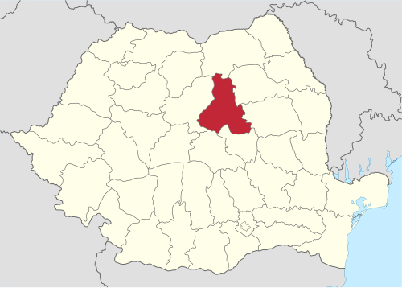{width=500}

---

Q: Ce județ (RO) are municipiul reședință Miercurea Ciuc (prescurtare HR)?
A: Județul Harghita
E: {width=500}

---

Q: Care este municipiul reședință al județului Hunedoara (HD)?
A: Deva
E: 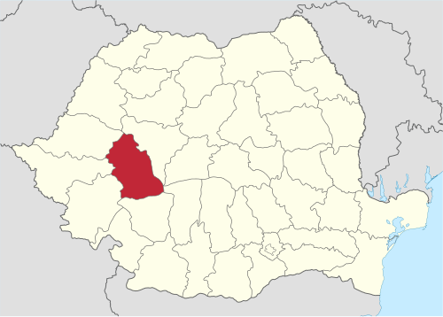{width=500}

---

Q: Ce județ (RO) are municipiul reședință Deva (prescurtare HD)?
A: Județul Hunedoara
E: {width=500}

---

Q: Care este municipiul reședință al județului Ialomița (IL)?
A: Slobozia
E: 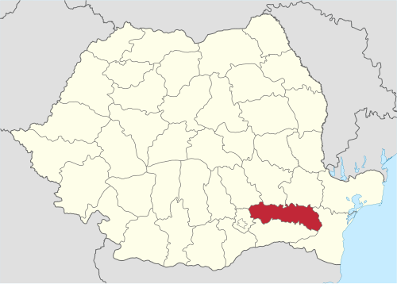{width=500}

---

Q: Ce județ (RO) are municipiul reședință Slobozia (prescurtare IL)?
A: Județul Ialomița
E: {width=500}

---

Q: Care este municipiul reședință al județului Iași (IS)?
A: Iași
E: 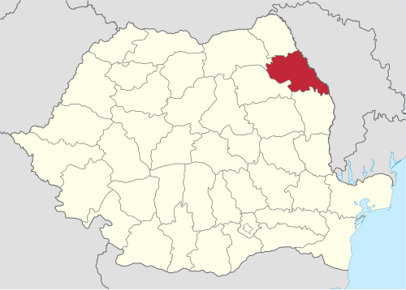{width=500}

---

Q: Ce județ (RO) are municipiul reședință Iași (prescurtare IS)?
A: Județul Iași
E: {width=500}

---

Q: Care este reședința județului Ilfov (IF)?
A: București *(sediul administrativ se află în Municipiul București)*
E: 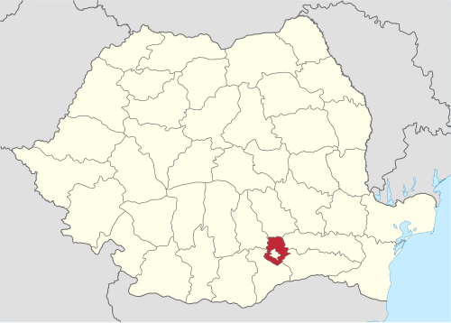{width=500}

---

Q: Ce județ (RO) înconjoară Capitala și are sediul administrativ în București (prescurtare IF)?
A: Județul Ilfov
E: {width=500}

---

Q: Care este municipiul reședință al județului Maramureș (MM)?
A: Baia Mare
E: 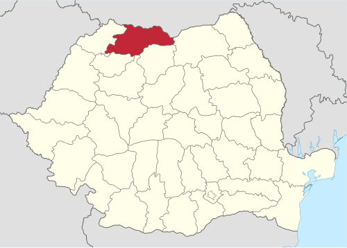{width=500}

---

Q: Ce județ (RO) are municipiul reședință Baia Mare (prescurtare MM)?
A: Județul Maramureș
E: {width=500}

---

Q: Care este municipiul reședință al județului Mehedinți (MH)?
A: Drobeta-Turnu Severin
E: 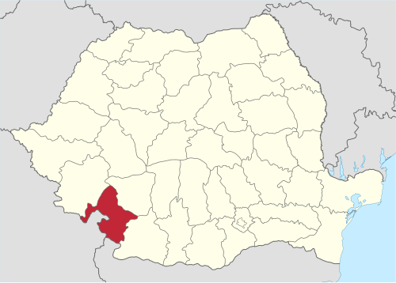{width=500}

---

Q: Ce județ (RO) are municipiul reședință Drobeta-Turnu Severin (prescurtare MH)?
A: Județul Mehedinți
E: {width=500}

---

Q: Care este municipiul reședință al județului Mureș (MS)?
A: Târgu Mureș
E: 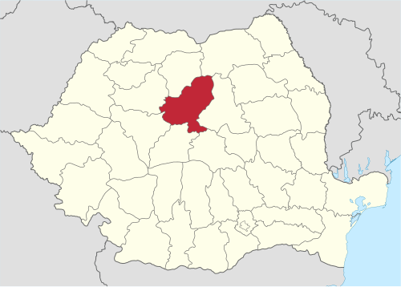{width=500}

---

Q: Ce județ (RO) are municipiul reședință Târgu Mureș (prescurtare MS)?
A: Județul Mureș
E: {width=500}

---

Q: Care este municipiul reședință al județului Neamț (NT)?
A: Piatra Neamț
E: 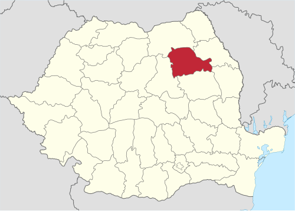{width=500}

---

Q: Ce județ (RO) are municipiul reședință Piatra Neamț (prescurtare NT)?
A: Județul Neamț
E: {width=500}

---

Q: Care este municipiul reședință al județului Olt (OT)?
A: Slatina
E: 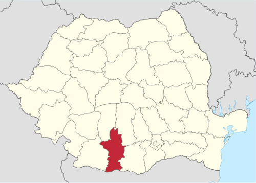{width=500}

---

Q: Ce județ (RO) are municipiul reședință Slatina (prescurtare OT)?
A: Județul Olt
E: {width=500}

---

Q: Care este municipiul reședință al județului Prahova (PH)?
A: Ploiești
E: 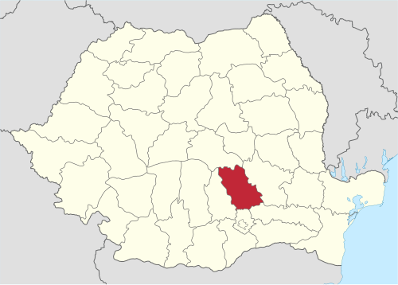{width=500}

---

Q: Ce județ (RO) are municipiul reședință Ploiești (prescurtare PH)?
A: Județul Prahova
E: {width=500}

---

Q: Care este municipiul reședință al județului Satu Mare (SM)?
A: Satu Mare
E: 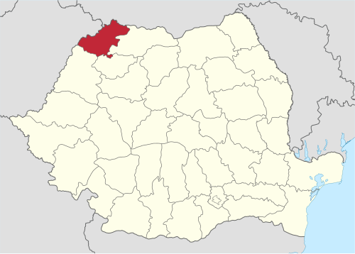{width=500}

---

Q: Ce județ (RO) are municipiul reședință Satu Mare (prescurtare SM)?
A: Județul Satu Mare
E: {width=500}

---

Q: Care este municipiul reședință al județului Sălaj (SJ)?
A: Zalău
E: 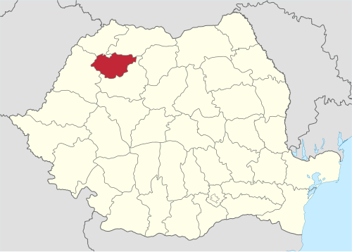{width=500}

---

Q: Ce județ (RO) are municipiul reședință Zalău (prescurtare SJ)?
A: Județul Sălaj
E: {width=500}

---

Q: Care este municipiul reședință al județului Sibiu (SB)?
A: Sibiu
E: 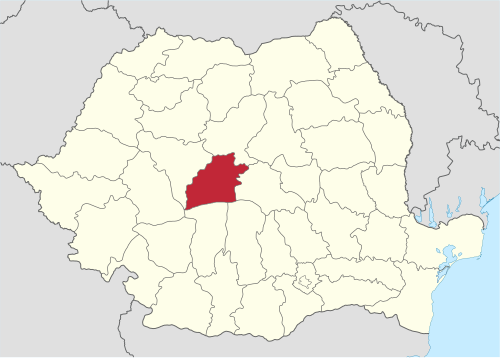{width=500}

---

Q: Ce județ (RO) are municipiul reședință Sibiu (prescurtare SB)?
A: Județul Sibiu
E: {width=500}

---

Q: Care este municipiul reședință al județului Suceava (SV)?
A: Suceava
E: 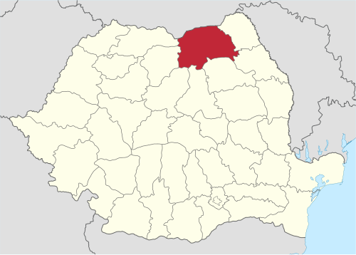{width=500}

---

Q: Ce județ (RO) are municipiul reședință Suceava (prescurtare SV)?
A: Județul Suceava
E: {width=500}

---

Q: Care este municipiul reședință al județului Teleorman (TR)?
A: Alexandria
E: 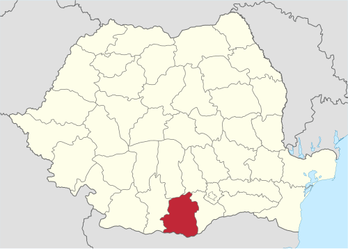{width=500}

---

Q: Ce județ (RO) are municipiul reședință Alexandria (prescurtare TR)?
A: Județul Teleorman
E: {width=500}

---

Q: Care este municipiul reședință al județului Timiș (TM)?
A: Timișoara
E: 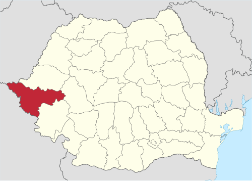{width=500}

---

Q: Ce județ (RO) are municipiul reședință Timișoara (prescurtare TM)?
A: Județul Timiș
E: {width=500}

---

Q: Care este municipiul reședință al județului Tulcea (TL)?
A: Tulcea
E: 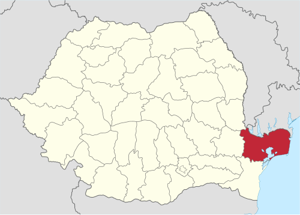{width=500}

---

Q: Ce județ (RO) are municipiul reședință Tulcea (prescurtare TL)?
A: Județul Tulcea
E: {width=500}

---

Q: Care este municipiul reședință al județului Vaslui (VS)?
A: Vaslui
E: 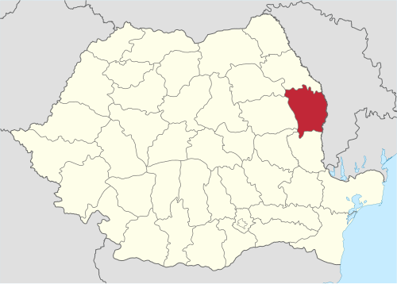{width=500}

---

Q: Ce județ (RO) are municipiul reședință Vaslui (prescurtare VS)?
A: Județul Vaslui
E: {width=500}

---

Q: Care este municipiul reședință al județului Vâlcea (VL)?
A: Râmnicu Vâlcea
E: 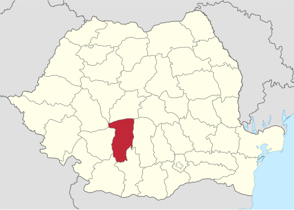{width=500}

---

Q: Ce județ (RO) are municipiul reședință Râmnicu Vâlcea (prescurtare VL)?
A: Județul Vâlcea
E: {width=500}

---

Q: Care este municipiul reședință al județului Vrancea (VN)?
A: Focșani
E: 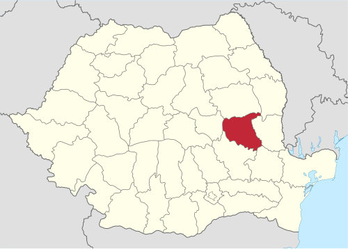{width=500}

---

Q: Ce județ (RO) are municipiul reședință Focșani (prescurtare VN)?
A: Județul Vrancea
E: {width=500}

---

Q: Care este statutul administrativ al Municipiului București (B)?
A: Capitala României; are statut de unitate administrativ-teritorială de nivel județean (repartizat în 6 sectoare), independent de județul Ilfov.
E: 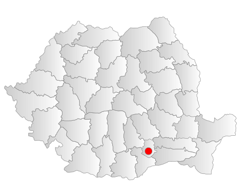{width=500}

---

# GEOGRAFIE::Romania::Regiuni_Istorice

Q: Ce județe fac parte din regiunea istorică Dobrogea?
A: 1. Constanța (CT)
2. Tulcea (TL)

---

Q: Din ce regiune istorică a României fac parte județele Constanța (CT) și Tulcea (TL)?
A: Dobrogea

---

Q: Ce județe fac parte din regiunea istorică Banat?
A: 1. Timiș (TM)
2. Caraș-Severin (CS)
*(Parțial: Arad - sud de Mureș, Mehedinți - extremitatea vestică)*

---

Q: Ce județe principale compun regiunea istorică Bucovina (partea sudică, din România)?
A: 1. Suceava (SV)
*(parțial nordul județului Botoșani)*

---

Q: Ce județe principale compun regiunea istorică Oltenia?
A: 1. Dolj (DJ)
2. Gorj (GJ)
3. Mehedinți (MH)
4. Olt (OT - vest de râul Olt)
5. Vâlcea (VL - vest de râul Olt)

---

Q: Ce județe principale compun regiunea istorică Transilvania (intracarpatică)?
A: Cluj (CJ), Brașov (BV), Sibiu (SB), Mureș (MS), Alba (AB), Covasna (CV), Harghita (HR), Bistrița-Năsăud (BN), Hunedoara (HD), Sălaj (SJ).